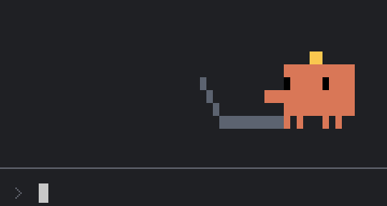
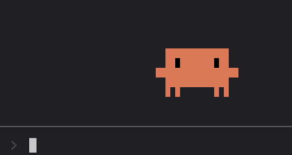
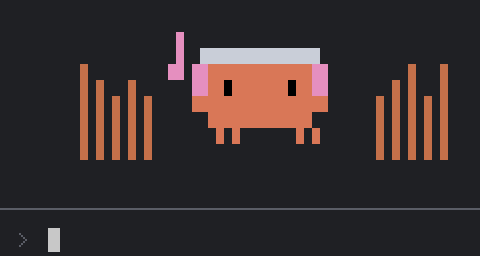
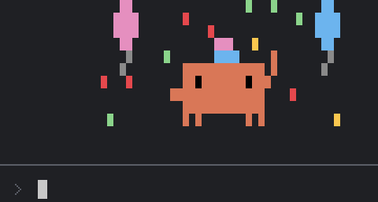

<h1 align="center">Clawd Pet</h1>

<p align="center"><b>English</b> | <a href="README.zh-CN.md">中文</a></p>

<p align="center">
  
</p>

<p align="center">
  Bring <b>Clawd</b>, Claude Code's pixel mascot, into your terminal and the Claude desktop app.<br>
  It lives above the prompt, acts out whatever Claude is doing, bubbles code while it types, dances to your music, hops when you click it, chats with you, and plays a game with you.
</p>

<p align="center">
  <a href="#whats-new">What's new</a> ·
  <a href="#install">Install</a> ·
  <a href="#commands">Commands</a> ·
  <a href="#talk-to-clawd">Talk to Clawd</a> ·
  <a href="#desktop-app">Desktop app</a> ·
  <a href="#game-mode">Game mode</a> ·
  <a href="#music-mode">Music mode</a> ·
  <a href="#settings">Settings</a> ·
  <a href="#development">Development</a>
</p>

---

## What's new

**0.1.0 — this fork**

- **Music mode on Linux.** Upstream could only listen through Core Audio on macOS. `native/clawd-ears.py` reads the default sink's monitor with `parec` instead, so `/clawd music start` works on PulseAudio and PipeWire with the same dancing, equalizer bars and beat-synced notes.
- **Right click opens the chat**, **middle click opens the game**, left click still hops. Nothing has to be typed to reach either.
- **A ✕ leaves the game**, at the far right of the score row, so a middle click is not the only way out.
- **Renamed** to `clawd-pet` throughout, and packaged as its own marketplace.

Everything from upstream 1.4.0 is here: the desktop app's pixel city, game mode, the chat pane, and every animation.

See [FORK.md](FORK.md) for the exact diff against upstream.

## What it does

<table>
  <tr>
    <td width="50%">
      <br>
      <b>Writing code</b><br>
      While Claude edits a file, Clawd sits side on at a little laptop, typing away, with bits of code like <code>{}</code> <code>&lt;/&gt;</code> <code>;</code> bubbling up from its head.
    </td>
    <td width="50%">
      <br>
      <b>Thinking · Reading · Running · Searching</b><br>
      Its pose follows the tool Claude is using: thought dots while it thinks, a page held up while it reads, a run while a command runs, a magnifying glass while it searches.
    </td>
  </tr>
  <tr>
    <td width="50%">
      <br>
      <b>Music mode</b><br>
      Headphones on, it bounces to the beat of whatever your Mac is playing, with notes floating up from its ear cups.
    </td>
    <td width="50%">
      <br>
      <b>Celebrations</b><br>
      When an answer took more than 5 seconds, it ends with a party or fireworks, picked at random.
    </td>
  </tr>
</table>

<p align="center">
  <br>
  <sub>In the terminal: click it and it hops</sub>
</p>

And a few small touches:

- **Always there**: while Claude waits for you, Clawd stands at the right end of the prompt, blinking and glancing around now and then.
- **Click it**: left click makes it hop with its arms up, winks its right eye, glances to each side, and rolls its eyes all around. Right click opens the chat with it; middle click opens the runner game (only the button is read, so holding a modifier works too on a terminal that keeps the bare press for itself).
- **Not selectable**: dragging to select text never picks up Clawd, so it never ends up in what you copy.
- **Plain captions**: beside it reads something like "Editing… · register.js". Only the file's name is shown, never anything else from a tool's input.
- **English and Chinese**: follows your system language, or pick one yourself.
- **Free to watch**: everything but the chat calls no model and uses no network. Chatting calls a model with your own Claude account, only when you send a message.

## Install

You need:

- **Claude Code 2.1.287 or later**, the first version that supports mods.
- **The terminal**, or the **Code tab of the Claude desktop app**. A few things are terminal only; see [Desktop app](#desktop-app).
- For **music mode**: macOS 14.2 or later with the Xcode command line tools (`xcode-select --install`), **or** Linux with `parec` and `pactl` (PulseAudio, or PipeWire with its pulse layer) and Python 3.

### From the plugin marketplace

In Claude Code, add this repository as a marketplace, then install the plugin from it:

```
/plugin marketplace add linxuan-sys/clawd-pet
```

```
/plugin install clawd-pet@clawd-pet
```

Or from your shell:

```bash
claude plugin marketplace add linxuan-sys/clawd-pet
```

```bash
claude plugin install clawd-pet@clawd-pet
```

Clawd appears in your next session. To get a newer release later:

```bash
claude plugin marketplace update clawd-pet && claude plugin update clawd-pet@clawd-pet
```

**Coming from upstream?** This plugin was called `clawd-buddy` (and before that `clawd-spinner`).
Remove that one and its marketplace first, then install as above:

```bash
claude plugin uninstall clawd-buddy@clawd-buddy && claude plugin marketplace remove clawd-buddy
```

### From source

To hack on it, clone it and start Claude Code with `--plugin-dir`:

```bash
git clone https://github.com/linxuan-sys/clawd-pet.git ~/mods/clawd-pet
```

```bash
claude --plugin-dir ~/mods/clawd-pet
```

To load your copy in every session without the flag, add this to `~/.claude/settings.json`, with your own absolute path:

```json
{
  "env": {
    "CLAUDE_CODE_PLUGIN_DIRS": "/Users/you/mods/clawd-pet"
  }
}
```

Changes to the code reload by themselves, with no restart.

## Commands

Type them in Claude Code. They work while Claude is answering, too.

Most of these also have a mouse shortcut: **right click** the mascot opens the chat, **middle
click** opens the game, and **left click** makes it hop. See [What it does](#what-it-does).

| Command | What it does |
| :-- | :-- |
| `/clawd show` | Brings Clawd back |
| `/clawd hidden` | Hides Clawd. It stays hidden in later sessions too |
| `/clawd music start` | Turns music mode on |
| `/clawd music stop` | Turns music mode off |
| `/clawd game` / `game stop` | Starts / ends [game mode](#game-mode) |
| `/clawd scene next` | Desktop app: shows the next time of day (morning, noon, dusk, night, then your local time again) |
| `/clawd scene morning\|noon\|dusk\|night` / `auto` | Desktop app: pins a time of day / follows your local time again |
| `/clawd scene off` / `on` | Desktop app: plain Clawd without the scene / the scene back |
| `/clawd idle fishing\|laptop\|garden\|sleep` / `auto` | Desktop app: pins what Clawd does while it waits / picks by the time of day again |
| `/clawd chat` | Opens the chat with Clawd, ready to type |
| `/clawd chat <message>` | Says something to Clawd |
| `/clawd chat close` / `clear` | Closes the chat / clears it |
| `/clawd model [name]` | Shows or switches the chat model: `haiku`, `sonnet`, `opus` or `main` |
| `/clawd effort [level]` | Shows or sets how hard it thinks: `default`, `low`, `medium`, `high`, `xhigh` or `max` |

## Talk to Clawd

Clawd doesn't only watch: you can chat with it.

- Run `/clawd chat`, or `/clawd chat hi Clawd!` to say something right away. A **chat pane** opens beside the transcript, or above the prompt in a narrow terminal, with the whole chat so far and a box to keep typing in. Press Esc to go back to the prompt; the pane stays, so you can keep reading.
- When Clawd answers, it hops, and a **speech bubble** with its reply pops up beside it for a few seconds. The full reply is in the pane.
- Clawd knows what's going on: what Claude is doing right now and your whole conversation with Claude so far, however long the session runs. It can't run tools or change files, so for real work it sends you back to Claude.
- The chat **stays out of Claude's conversation**: nothing you say to Clawd reaches Claude, and the chat is forgotten when the session ends.
- Choose who answers with `/clawd model sonnet` (or under **Chat model / 聊天模型** in `/config`, below), and how hard it thinks with `/clawd effort high`. Both are saved to your settings, and switching keeps the chat so far.
- The pane takes its background from Claude Code's theme, while the main transcript shows your terminal's own background. To have the pane match your terminal exactly, pick an ANSI theme with `/theme`: **Dark mode (ANSI colors only)** for a dark terminal (`"theme": "dark-ansi"`), or its light counterpart for a light one. With `light` in a dark terminal the pane comes out white; `dark` gives a dark gray close to most dark terminals.

### Pick the chat model

Clawd's chat has a model of its own, separate from the session's: run the session on Opus and chat with Clawd on Sonnet, say. The chat uses `haiku` until you pick another, and your pick becomes the default for every session after. Pick it any of these ways:

- **From the prompt**: `/clawd model sonnet`. Run `/clawd model` alone to see the current one.
- **In `/config`**: find **Chat model / 聊天模型** and choose.
- **In `~/.claude/settings.json`**, under the plugin's id (`clawd-pet@clawd-pet` when installed from the marketplace, `clawd-pet@inline` when loaded with `--plugin-dir`):

  ```json
  {
    "pluginConfigs": {
      "clawd-pet@clawd-pet": {
        "options": { "chatModel": "sonnet", "chatEffort": "default" }
      }
    }
  }
  ```

`/clawd effort` and **Chat effort / 聊天思考强度** set how hard it thinks the same way. What each model knows and costs is under [Settings](#settings).

## Desktop app

In the Code tab of the Claude desktop app, the card above the prompt becomes a small pixel city by the bay, after San Francisco: the Golden Gate, golden hills, a pyramid tower and a round-topped one, painted Victorian houses, palms and the waterfront.

<p align="center">
  <br>
  <br>
  <br>
  
</p>

- **It follows your local time**: morning from 5:00, noon from 10:00, dusk from 16:30, night from 19:30. Fog drifts through the Gate in the morning; at night the windows light up, the bridge's cable twinkles and the round tower's crown cycles through colors.
- **While Claude has nothing on**, Clawd keeps itself busy, a new pastime every few minutes: fishing off the waterfront (every so often a fish bites, comes up the line and lands in its bucket), coding at a café table with a coffee, watering a planter, or at night dozing on a bench under the lamp.
- **While Claude works**, Clawd acts it out in the scene as it does in the terminal, its caption and speech bubbles drawn there too.
- **Try it**: `/clawd scene next` steps through the times of day, `/clawd idle fishing` pins a pastime. `/clawd scene off` brings back plain Clawd.
- **Terminal only, for now**: clicking Clawd (the desktop app loads no `Client` module, so nothing in the card takes a click) and the hint for a command's arguments under the prompt.

## Game mode

`/clawd game` turns the band above the prompt into a runner game, like the browser's offline dinosaur. `/clawd game stop` ends it.

- **Jump**: with the prompt empty, press space (the space doesn't land in the prompt; with text in it, space types as usual). In the terminal a click on the track jumps too, and after that click space, up or w; Escape gives the keyboard back to the prompt. In the desktop app, press **Start**, which then turns into **Jump ↵**: press Enter to jump. Clicking anywhere on the card puts the focus back on it.
- **Faster and harder**: every 100 points the run speeds up and the score flashes, up to a top speed; taller cacti and pairs of them show up as it goes.
- **Your best score** is kept across sessions.
- **Out of the game**: middle click anywhere in it, or click the **✕** at the far right of the score row. (Only the button is read, never the modifiers, so a terminal that keeps the bare middle press for itself can still reach it with one held.)
- While you play, the captions and speech bubbles stay out of the way (the chat pane still works), and music mode waits: if it was on, Clawd goes back to dancing when the game ends.

## Music mode

**Turn it on**

1. Play some music, then run `/clawd music start`. The first time, it takes a few seconds to build the small program that listens.
2. macOS asks whether **clawd-ears may record system audio**. Click Allow.
3. Clawd puts its headphones on and starts dancing to the beat.

**No prompt, or you clicked Don't Allow?**

Open **System Settings → Privacy & Security → Screen & System Audio Recording**, find **clawd-ears** in the "System Audio Recording Only" list below, and switch it on. Then run `/clawd music stop` and `/clawd music start`.

**On Linux** the helper is `native/clawd-ears.py`, which reads the default sink's monitor with
`parec` instead of Core Audio: `pactl get-default-sink` names the sink, `parec` streams it, and
the same loudness-and-beat lines come out. It never opens the microphone, and the audio never
leaves the process. There is no permission to grant.

**What it hears**

- It reads what your Mac is playing through Core Audio. It **never uses the microphone**.
- Every 50 ms it works out only how loud the sound is, and whether a beat landed. The audio itself is never saved or sent, and never leaves that small program.
- The program runs only while music mode is on, and quits the moment you turn it off. It uses about 22 MB of memory and close to no CPU.

## Settings

In `/config`, find **Language / 语言**:

| Value | Effect |
| :-- | :-- |
| `auto` (default) | Follows your system language: Chinese when the first of `LC_ALL`, `LC_MESSAGES` and `LANG` that's set starts with `zh`, English otherwise |
| `zh` | Chinese |
| `en` | English |

And **Chat model / 聊天模型**, for who answers when you chat with Clawd:

| Value | Effect |
| :-- | :-- |
| `haiku` (default) | Fast and light. Gets what Claude is doing and a copy of your conversation so far (the newest 40,000 characters or so, each message's words and the tools and files it used) |
| `sonnet`, `opus` | The same copy, answered by a bigger model. Chat with Sonnet while the session itself runs on Opus, say |
| `main` | Forks the session's own conversation, on the session's own model, from its prompt cache: Clawd knows everything, with nothing cut. Costs more, and takes longer. Before the session's first answer, haiku stands in |

And **Chat effort / 聊天思考强度**, set with `/clawd effort`: `default` (leave it to the model), or `low` to `max`. Models without an effort setting ignore it, and `main` uses the session's own.

## How it's drawn

- Clawd is drawn with quadrant block characters (`▘ ▝ ▀ ▖ ▌ ▞ ▛ ▗ ▚ ▐ ▜ ▄ ▙ ▟ █`), four pixels to a character cell, the way Claude Code draws its own logo. Its shape is copied pixel for pixel from that logo.
- It's drawn in the mod band above the prompt, inside a `Client` region. A press on the region goes to Clawd, so it can answer clicks and can't be selected.
- In the desktop app the same pixels are drawn as an SVG, each pixel twice as tall as wide like a terminal cell's halves. The scene's motion is the SVG's own animation (SMIL), each loop started from the clock, so a new drawing picks up where the last one left off.
- A frame lasts 150 ms. Clawd redraws every frame only while it works, celebrates, dances or reacts to a click. While it waits, it redraws only when it blinks or glances.

## Development

```bash
claude plugin validate .        # Static check: the events and APIs the mod uses
```

```
clawd-pet/
├── .claude-plugin/
│   ├── plugin.json              Manifest: name, version, the language setting
│   └── marketplace.json         Makes this repository a marketplace you can install from
├── hooks/
│   ├── hooks.json               Points to register.js
│   ├── register.js              Every animation and all the logic
│   ├── clawd-view.js            The Client module that shows Clawd and takes clicks
│   ├── clawd-game.js            Game mode: its rules, the terminal's Client, the desktop's SVG
│   └── clawd-scene.js           The desktop app's city scenes and Clawd's pastimes
├── native/
│   ├── clawd-ears.swift         The program music mode listens with (macOS)
│   ├── clawd-ears.py            The same, reading the sink monitor (Linux)
│   └── Info.plist               The reason it gives when it asks to record system audio
├── types/index.d.ts             Declares the chat history kept for the session in $.state
├── docs/images/                 The animations in this README
├── tests/                       Tests for claude plugin test
├── FORK.md                      What this fork changes against upstream
└── LICENSE                      MIT
```

The changes this fork makes, and how to re-apply them when syncing upstream, are in [FORK.md](FORK.md).

## Credit

Clawd is the mascot of Anthropic's Claude Code. This is an unofficial mod, not a product of
Anthropic.

The mod itself is a fork of [clawdhouse](https://github.com/ishuagrawal/clawdhouse) by Ishu
Agrawal and [clawd-buddy](https://github.com/zhanbodev/clawd-buddy) by zhanbodev: the sprite,
the moods, the props, the physics, the rasteriser, the game, the scenes and the chat are
theirs. This fork renames it, adds a Linux audio helper, and puts the chat and the game on
mouse buttons. See [FORK.md](FORK.md).
